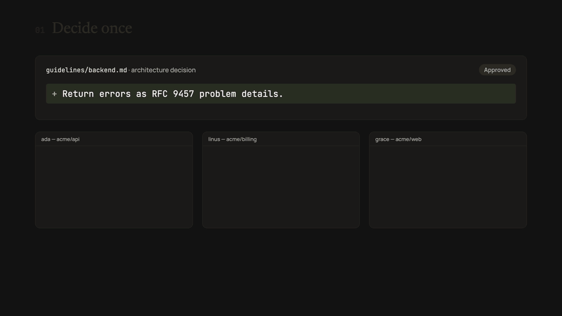
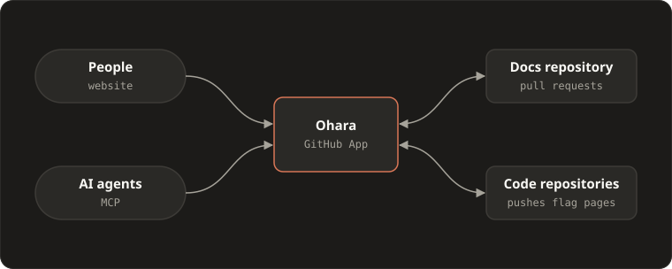

# Ohara

[](https://github.com/ntrossat/ohara/releases)
[](https://github.com/ntrossat/ohara/actions/workflows/ci.yml)
[](LICENSE)

**One place for all company knowledge, kept up to date by AI. You approve every change.**

**Decide once. Every agent, developer, and project follows it in minutes.**

**[Live demo](https://ohara.trossat.com/docs)**: Ohara's own docs, served by Ohara.

Ohara is an open-source documentation manager. Your docs and engineering guidelines live in one GitHub repository. People read them on a website, and AI agents read them through MCP. When the code changes, AI proposes the matching doc update as a pull request, and a human merges it.



[Watch the full video (1 min)](https://github.com/ntrossat/ohara/releases/download/v0.1.0/ohara-demo.mp4)

## Why Ohara

- **Decisions take weeks to reach the code.** An architecture or product decision lives in a meeting, a wiki page, and a copy of `CLAUDE.md` in every repository. With Ohara, it is one merged pull request: every coding assistant, in every project, follows it in minutes.
- **Knowledge is scattered** across Confluence, Jira, Google Drive, GitHub, and Slack. Ohara imports it into one repository.
- **Docs fall behind the code.** With Ohara, assistants update the docs in the same change as the code, and stale pages are flagged.

## How it works



- **Live guidelines.** Agents read the guidelines from Ohara when they work, not from copies in each repository. A merged change reaches every project on its next task.
- **Docs as code.** Plain Markdown in a GitHub repository. Folders become the menu. Every change is a pull request.
- **One docs pull request per code branch**, linked from the code pull request, so reviewers see both.
- **Freshness.** Pages name their owner, their last verified date, and the code they cover. Ohara flags them when that code changes or after six months.
- **Docs next to the code.** A code repository with a `.ohara.yml` keeps its own docs, and Ohara syncs them on each push.
- **Access mirrors GitHub.** A public repository makes a public website. A private one requires GitHub sign-in, and only people who can read the repository can read the docs.
- **Self-hosted.** One Docker container, and your docs stay in your GitHub repository.

## Commands

From Claude Code, once connected to Ohara's MCP server:

| Command | What it does |
|---|---|
| `/ohara:init` | Sets up a project: the GitHub App, `.mcp.json`, and the guidelines in `.claude/rules/ohara.md` |
| `/ohara:update` | Proposes doc updates from the project's latest code changes |
| `/ohara:review` | Reviews the project against the guidelines and docs |
| `/ohara:ingest` | Imports existing docs from Confluence, Jira, Google Drive, and more, as pull requests |

## Quick start

```sh
curl -fsSLO https://raw.githubusercontent.com/ntrossat/ohara/main/compose.yml && docker compose up -d
```

Open `http://localhost:8000`. For a public address, set `OHARA_URL` in a `.env` file next to `compose.yml`. The setup page creates a GitHub App: install it on your docs repository and your code repositories. Then connect your coding assistant and run `/ohara:init` in each project:

```sh
claude mcp add --transport http ohara <OHARA_URL>/mcp
```

The full documentation is at [ohara.trossat.com/docs](https://ohara.trossat.com/docs): install, configure, use, and how it works inside.

## Contributing

Contributions are welcome. See [CONTRIBUTING.md](CONTRIBUTING.md) and the [roadmap](docs/roadmap.md), and report security issues as described in [SECURITY.md](SECURITY.md).

If Ohara is useful to you, star the repository: it helps other teams find it.

## License

[Apache-2.0](LICENSE)
